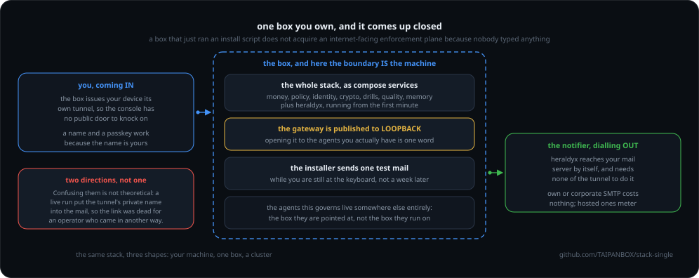
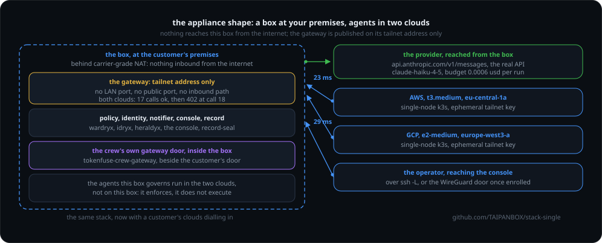

# The agent stack on one machine

One command puts the whole governed stack on a box you own, ready for agents
that live somewhere else entirely.

```bash
curl -fsSL https://raw.githubusercontent.com/TAIPANBOX/stack-single/main/install.sh | bash
```

<div align="center">



</div>

It comes up closed. The gateway is published to the host's **loopback**, so a
box that just ran an install script does not acquire an internet-facing
enforcement plane because nobody typed anything. Opening it to the agents you
actually have is one word:

```bash
GATEWAY_BIND=0.0.0.0 ./install.sh
```

Then point an agent at the gateway. Wherever that agent runs, in EKS, in a CI
job, on a laptop, its calls are metered, budgeted and policy-checked:

```bash
ANTHROPIC_BASE_URL=http://<your box>:4100
```

Every call carries a client key. The gateway does not answer a caller without
one, and the installer mints a key for your agents when you bring none: it is in
`/opt/agent-stack/agent-key`, and each call sends it as `x-fuse-key`, with an
agent id under `agent://local/agents/` as `x-fuse-agent-id` (see "Client keys and
the identity map" below).

On a box that is already installed, edit `GATEWAY_BIND` in
`/opt/agent-stack/.env` and `docker compose up -d`. Re-running the installer
will NOT widen it: `.env` is left alone once it exists, which is the same
property that stops a re-run rotating your credentials.

## Checking an installed box again: `./install.sh status`

Running the installer changes a box. To check the box without changing it, run
`status`. It runs the same checks the install runs at its end, against the stack
that is already up, and prints one line per check:

```bash
cd /opt/agent-stack     # any copy of install.sh works; STACK_DIR names the stack
STACK_DIR=/opt/agent-stack ./install.sh status
```

It exits 0 when every check passes and 1 when one fails. It installs nothing,
pulls no image, starts, stops or restarts no container, issues no device and
sends no mail. The checks that would write to the event bus, or send a call the
stack records (a refused metered call, a typed question), are printed as `skip`
and run only by the install. Run it as root, or as a user in the `docker` group.
If the box has no `.env`, `status` says so and stops before it calls anything.

## This is not the sandbox

[`stack-up`](https://github.com/TAIPANBOX/stack-up) is the local try: it binds
`127.0.0.1` on purpose, needs Rust, Go and Node on your machine, and stops when
you press Ctrl-C. It says as much about itself, and it is right to.

This is the other thing. The differences are the whole point:

| | `stack-up` | here |
|---|---|---|
| Reachable by an agent elsewhere | no, and it cannot be | yes, one variable away |
| Toolchains on your host | Rust, Go, Node, Python | docker and git |
| Where the planes come from | compiled on your machine | pulled from ghcr.io, pinned |
| Survives a reboot | no | yes |
| Console sign-in | no console at all | generated, shown once |
| Credentials | a dev key | unique per box, 0600, never printed twice |
| Governance routines on a schedule | six by default, plus an opt-in drill, as OS timers | none, see below |

That "yes" is measured once, 2026-09-17: on a gateway bound to the box's
tailnet address, the first reboot came back failed and the fix described
below made the second succeed in 40 s; the default loopback bind has not
yet been rebooted under measurement.

## What this box does not run

Two things a look at `compose.yaml` alone will not tell you, both about
absence rather than presence. An operator choosing between the three
deployment shapes (`stack-up`, this one, `stack-k8s`) should be able to see
both before installing, not after.

**No governance routines run on a schedule.** `stack-up`'s `routines.sh`
installs six OS-native timers for the stack's own recurring governance work by
default: a FinOps export, a crypto-inventory trend, a quality-drift check, an
identity-anomaly sweep, an on-box chain verification and the record seal. It also
has an opt-in fire drill. `stack-k8s` runs three of
those as CronJobs (`crypto-trend`, `quality-drift`, `identity-sweep`; its own
docs explain why the fourth, the FinOps export, cannot run as a CronJob
there). No install starts one of them. `compose.yaml` does define two of them as looping
services (`focus-export` and `verdryx-drift`) behind a `routines` profile that no
install enables, so `docker compose --profile routines up -d` would start them. Run
one by hand
inside the console container when you want it:

```bash
docker compose exec console verdryx drift --baseline <id>   # or qryx, ...
```

The identity sweep is defined here as a service you START rather than one that
loops, because a loop is impossible for it and not merely unwanted. It runs on the
idryx image, which is distroless: there is no shell for a
`sleep` loop, the binary is `/usr/local/bin/service` rather than `idryx`, and
`detect` has no `--interval`. So it takes the shape stack-k8s already uses for
the one job that must never start because a manifest was applied, and a person
runs it:

```bash
docker compose run --rm idryx-detect
```

It sits behind a `manual` profile that no install enables, which
`scripts/manifest-is-true.sh` checks in both halves: the profile has to be there,
and `install.sh` must never pass it. Put that line in your own cron if you want
it hourly, or add your own cron entry on the host calling `docker compose exec`. This
was not a documented choice before now; it is simply what the installer and
the compose file do, and it is worth knowing before you pick this shape over
the other two.

**The memory plane, `engram`, is not a separate service here**, the same way
`verdryx`, `qryx` and `mockryx` are not: `compose.yaml` names no `engram`,
`verdryx`, `qryx` or `mockryx` container, because none of the four is meant
to be one. `stack-k8s`'s own README explains why (its "Fact 2"): the console
reaches each of them by EXECUTING it, or, for `engram-mcp` specifically, by
speaking MCP over stdio to a child process, and "a sidecar container cannot
be another container's stdin." So all four have to live inside the console's
own image or not run at all.

They do live there. `install.sh` clones `verdryx` and `engram` as sources
(the same `for r in ... verdryx engram` loop that clones every other plane,
above) and builds the console from the identical
`stack-k8s/images/console.Dockerfile` that bakes both into `stack-k8s`'s
console image, the same `pip install` step and all. Based on reading that
build, not on having run it: the underlying binaries appear to be present
here exactly the way they are in `stack-k8s`'s console, which is a different
claim from "the memory plane works here", and both stacks share the same
further gate regardless of deployment shape: `genaryx`'s own discovery code
(`memory/env.rs`) refuses to show a Memory panel until its store already has
a file with real data in it, so a console that has never actually run an
Engram session reports "no memory plane" on `stack-up`, here, and on
`stack-k8s` alike, until an operator does something once. If there is a
concrete reason this box's memory plane cannot work that a closer look would
find, it is not in `install.sh`, `compose.yaml`, or the Dockerfile it builds
from.

## Reaching the console: this box issues your device its own tunnel

The console is on loopback, so it is reached over a tunnel rather than exposed.
This box runs the WireGuard side itself: sign in, open Remote, and it mints
your laptop or phone a peer config as a QR. Scan, connect, and the console
answers over HTTPS on the name it was configured with, inside that tunnel and
nowhere else - see the next section, because that name is not optional if you
want passkeys to work at all.

Issuing a device and revoking one both require a passkey, the same ceremony a
kill, a budget change or an approval decision does: a peer config is a road
into the control plane, so a stolen console session must not be able to mint
one quietly. Your first device is issued by `install.sh` itself, not the
browser: a passkey cannot be enrolled before a tunnel exists, so the browser
has nothing to issue the first device from. Every device after that goes
through the console once you have one.

The sequence for your first session:

1. import the `.conf` file `install.sh` printed the path to (or scan the QR
   it printed on that run) into your WireGuard client, and connect
2. open `https://<your CONSOLE_DOMAIN>`, trusting this box's own CA first if
   you did not set `CLOUDFLARE_API_TOKEN` (see the next section)
3. sign in with the password `install.sh` printed
4. enrol a passkey under Session > Passkeys

Only after step 4 do kill, budget, approval and device commands work.

SSH is still how you read the console before the tunnel exists, not how you
act on it: a passkey cannot be enrolled over an SSH forward, because WebAuthn
checks the origin, and that forward is `http://localhost`, never your console
domain.

```bash
ssh -L 17420:127.0.0.1:7420 root@<your box>
```

**Alerts do not need any of this.** The notifier dials outward to your mail
server; the tunnel exists to let you IN. A box with no tunnel and no device
still writes to you when one of your agents crosses a line. What the tunnel
decides is only whether the one link in that mail can be opened.

So the link is settable, in `.env`:

```
ALERT_CONSOLE_URL=''                        # use CONSOLE_DOMAIN, i.e. the tunnel
ALERT_CONSOLE_URL='http://localhost:17420'  # you reach the console over ssh -L
```

Leave it empty with no tunnel either, and the mail says it carries no link
rather than carrying a dead name.

Two details worth knowing rather than discovering:

- `51820/udp` is published, and it is the one port here that has to be. Unlike
  an HTTP plane, WireGuard answers nothing at all without a valid key: no
  banner, no handshake, nothing for a scanner to find.
- The tunnel runs in its own `wg` container because it needs `NET_ADMIN` and a
  tun device. The console holds neither: it manages peers through a
  group-readable UAPI socket on a shared volume. That split is checked by the
  installer from the console's side, because a tunnel that is up while the
  console cannot reach its socket looks perfectly healthy from outside.

### The notifier's daily pulse and quiet hours (set in `.env`)

Mail to your server is sent over TLS. `SMTP_TLS` in `.env` chooses how (heraldyx 0.8.0):
unset is STARTTLS, which is what a server on port 587 or 25 offers, and implicit TLS on port 465
selects itself. `starttls` and `implicit` name the two modes explicitly. `plain` is refused for
any host that is not loopback (`127.0.0.0/8`, `::1` or `localhost`), so a relay on the box
itself is the only place it can go. A server that offers no STARTTLS is refused rather than
sent to in the clear. The installer asks for the mode after the server address, and a value it
does not read is refused before anything is installed.

Once a recipient is set (`ALERT_TO`), the notifier sends one mail a day saying it is alive, with
the numbers it saw. If that mail stops arriving, the notifier or its mail path is down. Three
settings in `.env` change how it behaves. Without them you get the defaults shown:

```
HERALDYX_PULSE_HOURS=24       # how often the pulse goes out; 0 turns it off
HERALDYX_QUIET=22:00-07:00    # quiet hours as HH:MM-HH:MM; empty is off
HERALDYX_TZ=Europe/London     # the IANA zone the quiet hours are read in
```

During quiet hours, alerts below critical are held and reported in one mail when the hours end.
A critical is always sent at once. If `HERALDYX_TZ` is empty, the hours are read in the
notifier's own zone, so set it to be sure. A value the notifier cannot read turns quiet hours off
and says why in its log.

## Giving the console a real name, so passkeys work

The tunnel is enough to reach the console, and not enough to secure it. A
passkey ceremony cannot run at `https://10.9.0.1` no matter how it is
configured: WebAuthn requires a secure context AND refuses a bare IP as the
party it binds credentials to. So the console needs a name and a certificate,
even though nothing outside your tunnel can reach it.

Out of the box you get a working TLS console on a private name with Caddy's own
CA. That is fine for one operator who does not mind trusting that CA on each
device, and wrong for anything else, because such a CA can issue a certificate
for ANY name to a device that trusts it.

A real name costs two values in `.env` and nothing else:

```bash
CONSOLE_DOMAIN=something-unguessable.box.example.com
CLOUDFLARE_API_TOKEN=<a token scoped to Zone:DNS:Edit on that one zone>
```

Then `docker compose up -d caddy console`. Caddy switches from its internal CA
to Let's Encrypt on its own, and the console's WebAuthn identity follows the
same name, so the relying party, the origin and the address you type are one
value instead of three kept in agreement by hand.

Four things worth knowing before you do it:

- **The A record points at `10.9.0.1`**, the tunnel address, and must be **DNS
  only** (grey cloud). A proxied record cannot reach a private address. Public
  DNS pointing at a private IP is normal and is how every "reach my private
  thing by name" product works.
- **DNS-01, not HTTP-01.** The box publishes nothing on 80/443 and should not,
  so there is nothing for an HTTP challenge to answer. DNS-01 proves ownership
  with a TXT record, which works for a machine the internet cannot reach.
- **Pick an unguessable name.** The record is public, so anyone can learn that
  the name exists. `console.example.com` is an invitation to scan;
  `e02-k7m2.box.example.com` is a string with no value to anyone.
- **A passkey is bound to the name.** Changing the domain later invalidates
  every passkey enrolled at the old one; they must be enrolled again. Nothing
  is lost, but do not discover it during an incident.

Remove the token later and Caddy quietly falls back to its internal CA, which
breaks passkeys again. If you set it, leave it.

## What comes up

Ten containers and a one-shot `init-volumes` that exits, wired exactly as the
Kubernetes deployment wires them, because service names resolve the same way in
both. They sit on five Docker networks, not one; see "Networks" below for who is
on which, and why an agent's container has no route to the internet:

| Service | Port | Published to a host port |
|---|---|---|
| `tokenfuse-gateway` | 4100 | **yes**, `GATEWAY_BIND` decides where: loopback by default. Every call needs a client key (see "Client keys and the identity map") |
| `tokenfuse-cloud` | 8080 | no |
| `wardryx` | 8090 | no |
| `idryx` | 8081 | no |
| `policy-db` (postgres) | 5432 | no |
| `console` | 7420 | loopback only |
| `caddy` | 443 | no, it is reached over the tunnel, on the name in `CONSOLE_DOMAIN` |
| `wg` | 51820/udp | **yes**, and it is the one port here that has to be |
| `heraldyx` | none | it has none. It reads the event volume read-only and dials your mail server, so nothing ever calls it |
| `agent-conform` | none | it has none. It re-checks the hash chain of every event stream every five minutes and writes one file of its own on the bus. See "The chain verifier" below |
| `scopyx` | none | **opt-in, off unless you ask for it.** Inside the compose network only. See below |
| `typryx` | none | **opt-in, off unless you ask for it.** Inside the compose network only. See below |
| `tokenfuse-mcp-broker` | 4200 | **opt-in, off unless you ask for it.** `GATEWAY_BIND` decides where, same as the gateway. See below |
| `tokenfuse-gateway-openai` | 4110 | **opt-in, off unless you ask for it** (`OPENAI_DOOR=1`). A second gateway for agents that speak the OpenAI wire; `GATEWAY_BIND` decides where, same as the gateway. See "A second door on the OpenAI wire" below |
| `typryx-wardryx-proxy` | none | **opt-in twice, off unless you ask for it** (typed answers on, and `TYPED_RISK_SIGNAL=1`). Reachable only from the broker and wardryx. See "A risk signal on tool calls" below |
| `vouchryx` | none | **opt-in, off unless you ask for it.** Inside the compose network only. See "Delegation" below |
| `keyryx` | 4340 (compose network only) | none. Key custody: it holds the keys that sign approvals and seal roots. See "Key custody and the witness" below |
| `keyryx-witness` | none | none. It has no network at all. It reads the event record and checks it. See "Key custody and the witness" below |
| `costcrew` | 8321 | **opt-in, off unless you ask for it** (profile `finops`; `install.sh` never starts it). Loopback only. See "The FinOps console" below |

### Networks

Before this release every container shared one Docker network and every one of
them had a route to the internet, so an agent that could reach a model provider
directly never needed the gateway. Now there are five networks:

| Network | Internal | Who is on it |
|---|---|---|
| `edge` | no | the one route out: heraldyx (mail), the gateways (provider calls), scopyx and the browser (the web), wg and caddy. typryx and its risk-signal proxy join it only when `TYPED_MODE` is `jev` or `own-model`, because only then do they call a provider |
| `agents` | yes | where an agent's container joins (`agent-stack_agents`). Its only peers are the two gateways, the MCP broker, scopyx, the browser, the console and costcrew |
| `core` | yes | the planes, which reach each other and the doors. No agent container is on it |
| `risk-signal` | yes | the typed risk signal's proxy, the MCP broker and wardryx, and nothing else |
| `browser-policy` | yes | the browser's one path to a decision: scopyx-browser and wardryx, which decides every fetch the browser makes, and nothing else |
| `front` | no, with NAT off | the published ports: caddy, console, costcrew and the MCP broker. Nothing outbound is translated, so a container here cannot use the host as a route out |

An agent's container on `agents` reaches the gateways, the broker and scopyx.
It cannot resolve a name on the internet, cannot connect to an address on it,
and cannot reach a plane by name. `install.yml` checks those three things on a
fresh runner, on every install leg, after a positive control on `edge` so a
runner with no internet cannot pass them by accident.

What this means for you:

- An agent container you run yourself joins `agent-stack_agents`:
  `docker run --network agent-stack_agents ...`. Its model calls go through the
  gateway, with its client key, like any other metered call. A container left on
  the old default network has lost its route to the internet, which is the point.
- The browser container (scopyx-browser) is on `edge`, because it fetches the
  web. Its containment is the proxy scopyx owns, not the network: a compromised
  browser can open a connection over `edge` itself. Closing that needs the
  browser to reach the web only through scopyx on an internal network, which is a
  design change and is not done here.
- The browser asks wardryx before every fetch. It reaches wardryx through
  `browser-policy`, a network of its own whose only other member is wardryx, so
  the browser is not on `core`. The path is measured at the network level (a
  container on it reaches wardryx and not the gateway or the internet). No fetch
  through the `egress-browser` profile has run in CI yet, so whether the profile
  decides each fetch end to end is not proven by this release.
- The host firewall is untouched. An agent that runs as a process on the host,
  rather than in a container, is outside all of this.

Docker watches the services the installer checks on their health paths:
`tokenfuse-gateway`, `tokenfuse-gateway-openai` (when the door is on),
`tokenfuse-cloud` and `console`. `docker compose ps` shows each as `healthy` or
`unhealthy`, and the installer's checks are no longer the only look at them. A
healthcheck only reports: compose still restarts a service by its own rule, and
nothing here restarts one because of a failed check. `wardryx`, `idryx`,
`typryx` and `vouchryx` have no healthcheck, because their images are distroless:
they have no shell and no curl or wget to ask with, and this installer does not
add a tool to an image it does not build. `./install.sh status` is the check that
covers them.

The gateway's own observability and kill routes (`/v1/runs`, `/v1/keys` and
three more) take a per-install admin key: `GATEWAY_ADMIN` in `.env`, minted
by `install.sh` and presented by the console as `TOKENFUSE_GATEWAY_ADMIN_KEY`.
A request with no key, or the wrong one, is refused. Widening `GATEWAY_BIND`
no longer widens those routes to anyone without the key: it decides who can
reach the port, the key decides who those five routes answer once reached.

Clearing a run's taint label is a sixth door with a key of its own. The
gateway's `POST /v1/fuse/declassify` (the release valve for its agent firewall:
a person reviews a run and the label comes off it) is not behind the admin key.
It takes `x-fuse-declassify-key`, and `install.sh` mints that key into `.env` as
`GATEWAY_DECLASSIFY_KEY`, handed to the gateway as `TOKENFUSE_DECLASSIFY_KEY`.
Without a key configured, the gateway lets anything that reaches the port clear
a run, so this is set by default and only whoever can read `.env` holds it.
Nothing in this stack calls the endpoint. To clear a run, read the key from
`.env` and send it in that header; a call with no key or the wrong one is
refused. An install from before this release gets the key on its next run of
the installer, which adds it without touching any credential already there.

### The most one run can be allowed to spend

A run's budget used to be whatever the agent said: it sends
`x-fuse-budget-usd`, and its next call could widen it again. The gateway
(tokenfuse 1.5.0) now clamps a budget that came from that header, from a policy
default or from its own built-in default to one figure, on every call, and
tells the caller when it did by adding `x-fuse-budget-clamped: <figure>` to the
answer. The figure is **5.00 USD** unless you say otherwise, which is
tokenfuse's own default run budget, so an ordinary run is untouched and only an
agent that declares more is lowered. A budget you set in the Cloud is your own
word and is never clamped, and a caller may always ask for less.

```bash
RUN_BUDGET_CEILING_USD=25 ./install.sh      # a positive number of dollars, at most six decimals
```

On an installed box, set `RUN_BUDGET_CEILING_USD` in `/opt/agent-stack/.env` and
`docker compose up -d`. The installer refuses a value the gateway would refuse
to start on (zero, a sign, an exponent, a seventh decimal), before it touches
the box, and also one already left in `.env`. It bounds one run, not an agent:
an agent that opens a new run id gets a new run's worth, which only unit caps
or a budget tied to an identity close. `install.sh` checks the gateway's own
start-up line to see the clamp is armed, so a gateway older than 1.5.0 turns
that check red instead of reading as bounded.

### The agent firewall runs in enforce

The gateway's agent firewall judges what a run may do after it has read
untrusted input: it has read a web page, an email or a file, and the model then
asks for a command, a write or a send to the network. On this box it runs in
**enforce**, the default on every install. When a run has read untrusted input
and the model asks for one of those actions, the gateway withholds the answer:
the caller gets HTTP 403 with `taint_blocked`. The model call itself has already
happened, so it is still recorded and billed. A run that holds a secret and asks
to send data out is refused the same way.

Enforce judges the buffered answer. A streamed answer is not judged by this
firewall in this release, so a tool use inside a stream is not withheld.

To run it in **shadow** (it records what it would refuse and refuses nothing) or
**off** instead, set the switch and run the installer, which checks the value
before it touches the box:

```bash
TOKENFUSE_FIREWALL=shadow ./install.sh      # or off; enforce is the default
```

On an installed box, set `TOKENFUSE_FIREWALL` in `/opt/agent-stack/.env` and run
`docker compose up -d tokenfuse-gateway`. The installer refuses any other value
and one already left in `.env`. tokenfuse also exits at start on a misspelling
(exit 2), so a typo cannot quietly run shadow.

### Personal data in prompts (shadow by default)

On every box the gateway looks for personal data in prompts and tool arguments, and
the MCP broker does the same when typed answers are on: email addresses, payment card
numbers that pass a Luhn check, and international phone numbers. The default is **shadow**, which records what it finds
and lets the call through unchanged. The gateway adds an `x-fuse-dlp` header to its
answer with the kinds found and a count, never the values. The broker logs a warning
and, on a tool response, marks `_tokenfuse.dlp_pii`. Neither writes an event to the
shared bus.

One switch moves both scanners:

```bash
TOKENFUSE_DLP_PII=mask ./install.sh      # or off, block; shadow is the default
```

`mask` replaces each finding with a `[REDACTED:kind]` marker before the call is
forwarded. `block` refuses a call that carries a finding, including a false positive.
Read what either does to your agents' traffic before you turn it on.

On an installed box, set `TOKENFUSE_DLP_PII` in `/opt/agent-stack/.env` and run
`docker compose up -d tokenfuse-gateway`. The installer refuses any value outside
`off`, `shadow`, `mask` and `block`, and so does tokenfuse, which exits at start on a
value it cannot read rather than switching detection off.

### Which models an agent may use (you write it, nothing is seeded)

A policy can name the models its agents may use. wardryx 1.5.0 reads `allow_models`:
a model call whose `model` matches none of the entries is denied, and a model
call whose model is empty is refused. An entry is a model id or a glob (`*` any run
of characters, `?` one character), matched exactly, so `Claude-Sonnet-5` is not
`claude-sonnet-5`. When several matched policies set a list, each of them has to
name the model. Tool calls are not judged by it. This launcher seeds no such list,
so until you write one every model passes, as it did before. tokenfuse sends the
model with each decide request, so the list reaches the model calls the gateway
makes. Not measured here against a live provider.

```yaml
- name: support-fleet
  target: "agent://<your trust domain>/support/*"
  allow_models:
    - "claude-sonnet-*"
    - claude-haiku-5
```

Add it to `/opt/agent-stack/policy.yaml` beside the rule above and run
`docker compose restart wardryx`. A decision under a list is never cached, so each
model call reaches wardryx.

### Client keys and the identity map (on by default)

The gateway answers no caller without a client key, and a key may speak only as
the agent ids the identity map binds it to. Without them the gateway admitted
anyone who could reach it and took the agent id a caller wrote, so one agent
could speak as another and take its policy and its budget. Compose refuses to
start the gateway without keys, and the map runs strict (`TOKENFUSE_IDENTITY_STRICT:
enforce`).

**Given no files, the installer mints two keys** and a map binding each:

| Key id | Unit | May speak as | Its secret |
|---|---|---|---|
| `felyx` | `console` | `agent://<trust domain>/genaryx/felyx`, exactly | `GENARYX_COPILOT_FUSE_KEY` in `.env`; the console sends it for Felyx |
| `agents` | `agents` | `agent://<trust domain>/agents/*` | `GATEWAY_AGENT_KEY` in `.env`, and the file `/opt/agent-stack/agent-key` (0600) |

The trust domain is `RECORD_TRUST_DOMAIN` from `.env`, `local` when it is unset.
The end of the run names the file and the ids and never prints a key. Your agents
then send, on every call:

| Header | Value |
|---|---|
| `x-fuse-key` | the secret in `/opt/agent-stack/agent-key` |
| `x-fuse-agent-id` | an id under `agent://local/agents/`, such as `agent://local/agents/support-bot` |
| `x-fuse-run-id` | its run, as before |

A call with no key, or one the gateway does not hold, is refused 401; the key
speaking as an id outside `agents/` (Felyx's included) is refused 403
`identity_mismatch`. The units carry no budget: the map binds and attributes, and
a monthly cap is yours to set in a map of your own. A re-run keeps every minted
key byte for byte and rebuilds the same map; to rotate one, empty its line in
`.env` and run the installer again, which mints a new one. An installed box from
before this release gets its keys on its next run of the installer, and its agents
are refused 401 until they send one; `docker compose up` on its old `.env` stops
at the missing `GATEWAY_CLIENT_KEYS` rather than starting a gateway that answers
anyone.

**One key for all your agents is the floor.** To give each agent its own key and
unit, bring two files, prepared by you or by an onboarding agent (the console's
Onboard tab prints both pieces). On a box whose keys were minted, give both files
together: the minted map binds the minted keys only.

- a **keys file**: one `secret:key_id` per line. The secret is what one agent
  presents; the key id is the name the gateway records its spend under. Blank
  lines and `#` comments are ignored.
- an **identity map**: tokenfuse's JSON map ([docs/20](https://github.com/TAIPANBOX/tokenfuse/blob/main/docs/20-identity-map.md))
  of units (a team or business unit, with an optional monthly budget), which key
  belongs to which unit, and which agent ids each key may speak as.

```text
# keys.txt
gx_3f0c9a...:treasury-bots
gx_9b21d4...:research-bots
```

```json
{
  "units": [
    {"id": "treasury", "owner": "user://bank.example/olena", "budget_usd_month": 2000},
    {"id": "research", "budget_usd_month": 300}
  ],
  "keys": [
    {"key_id": "treasury-bots", "unit": "treasury", "agents": ["agent://bank.example/treasury/*"]},
    {"key_id": "research-bots", "unit": "research", "agents": ["agent://bank.example/research/*"]}
  ]
}
```

```bash
CLIENT_KEYS_FILE=/path/keys.txt IDENTITY_MAP_FILE=/path/identity.json ./install.sh
```

What an agent then sends, besides its provider key, on every call:

| Header | Value |
|---|---|
| `x-fuse-key` | its own secret from the keys file |
| `x-fuse-agent-id` | an id the map binds to that key, such as `agent://bank.example/treasury/recon-batch` |
| `x-fuse-run-id` | its run, as before |

A call with no key, or a key the gateway does not hold, is refused 401. A key
speaking as an agent its binding does not name, or naming none, is refused 403
`identity_mismatch` before anything reaches a provider. Its spend lands in the
key's unit, and with `TOKENFUSE_MODE` enforce (this box's setting) a unit over
its monthly budget is refused 402.

The installer checks both files before anything restarts, in two steps. Before
it installs a package, the shell grammar: each file is readable and not empty,
each key line is `secret:key_id` with a secret of 24 to 256 characters from
`A-Z a-z 0-9 . _ ~ + / = @ : -` and a key id from `A-Z a-z 0-9 . _ -`, no secret
appears twice, and the map is a JSON object. Then, once the images are on the
box, the gateway image itself reads the pair in a throwaway container with no
network, so its own parser decides: a unit the map does not declare, a bad
pattern, a map that configures nothing (an empty file or `{}`), a map key id no
secret carries, and a key the map does not bind (every call with it would be
refused 403) are each refused, and nothing is written. A refusal names the line,
never the secret.

The keys are kept in `.env` (0600) as `GATEWAY_CLIENT_KEYS` and are never
printed. The map is kept at `/opt/agent-stack/identity/identity.json` and
mounted read only into the gateway. A re-run that names neither file keeps both
and checks them again; naming one replaces it, and a new map restarts the
gateway, which reads the map only at start. The map can be turned off by removing
`GATEWAY_IDENTITY_MAP` from `.env` and running `docker compose up -d
tokenfuse-gateway`; the keys cannot, the gateway requires them.

The keys file can hold only the keys, with no map: callers are then
authenticated and their spend attributed by key id, with no agent binding. A map
with no keys file is refused: the gateway requires keys, and a map's bindings
would name keys the box does not have.

Felyx, the console's copilot, calls this gateway like any agent, so it needs a
key of its own. On a box given no files it has the minted `felyx` key. With your
own files, give it a line in the keys file and a binding, as below; with
`GENARYX_COPILOT_FUSE_KEY` empty, Felyx sends no `x-fuse-key` and its calls are
refused 401. The installer says which of these your box has at the end of the
run. Felyx authenticates with this key and never with your provider key.

A console that carries genaryx invariant 24 can present a key of its own:
`compose.yaml` already hands it `GENARYX_COPILOT_FUSE_KEY_REF`, which points at
`GENARYX_COPILOT_FUSE_KEY` in `.env`, and such a console sends that key as
`x-fuse-key`. The console pinned here (v1.1.48) carries it; an older one ignores
the setting. Measured 2026-10-13 with two throwaway v1.1.44 consoles against a
gateway holding client keys: with the key set, a question to Felyx was answered;
with it empty, the gateway answered 401. To give Felyx a key:

1. Give Felyx its own line in the keys file, such as `gx_7d42e1...:felyx`.
2. If you use an identity map, bind that key id in `keys[]` with `agents`
   naming Felyx's agent id, `agent://<RECORD_TRUST_DOMAIN>/genaryx/felyx`
   (`agent://local/genaryx/felyx` when `RECORD_TRUST_DOMAIN` is unset), and the
   unit its spend should land in. The installer refuses a key the map does not
   bind.
3. Run the installer with both files again, as above.
4. Put the same secret in `.env`, single-quoted, as
   `GENARYX_COPILOT_FUSE_KEY='gx_7d42e1...'`, and run
   `docker compose up -d console`.

Left empty, the default, Felyx sends no key, as before, and with client keys on
its calls are refused 401.

### The provider key: the gateway holds it, never an agent

The gateway holds your model provider's key, so an agent never needs it. Give the
key to the installer as a file, not as a value:

```bash
ANTHROPIC_KEY_FILE=/path/to/anthropic.key ./install.sh
```

The installer copies it to `./upstream/anthropic/key` (mode 0400, owned by the
gateway's user) and mounts that directory read only into the gateway alone. A
re-run keeps the file. `OPENAI_KEY_FILE` does the same for the OpenAI door, into
`./upstream/openai/key`. Agents present their gateway key. A call that carries a
provider key of its own is refused 401 `provider_credential_refused`.

With no key file the gateway forwards a caller's own key, as it did before, and
the closing report says so. A key the gateway holds pays for every agent's
calls, so it is never taken from elsewhere without your word: a box that has only
`GENARYX_COPILOT_KEY` in `.env` (the key Felyx held before 1.2.0) stops before
anything is changed and names the two ways on, `ANTHROPIC_KEY_FILE=<file>` or
`GATEWAY_HOLDS_COPILOT_KEY=1`, which moves that `.env` value into the gateway's key
file. The `.env` line stays, unused, so remove it once you are sure.

Upgrading: Felyx now authenticates with its own gateway key, not the provider
key. A box given its own keys file needs `GENARYX_COPILOT_FUSE_KEY` in `.env`,
with the same secret on a line of the keys file, or Felyx is refused 401.

### Agent tokens: an agent's own credential (the default, with a named list of static keys)

By default the gateway and the MCP broker require an agent token. A static client key is
admitted only when its key id is named on an allow-list the installer writes, and wardryx checks
an agent's token itself rather than taking the gateway's word for who the agent is. This is what
the installer does with no setting at all:

```bash
./install.sh            # agent tokens on, the default
WITH_AGENT_TOKENS=0 ./install.sh   # the weaker way out: static keys only, as before
```

The installer prints the allow-list in its closing report, under "static keys still admitted;
move these agents to tokens". On a fresh box that list is the console's own key (`felyx`) and the
broker's taint-relay key (`broker`), because neither can sign a proof. On a re-run it also keeps
every key id the box already had, so nothing that worked yesterday stops. To keep another client,
name its key id in `STATIC_KEY_IDS` (comma-separated, for a client that cannot sign a proof), and
the installer refuses a name that is not one of the box's keys. Moving an agent to a token is the
way to take it off the list.

#### Upgrading a box with static-key agents (1.3.0)

- An agent that calls with a static key it does not hold on the list is refused `401`
  `agent_token_required` after the first run of this release. The same key on a re-run keeps
  working, because the re-run keeps every key id the box already had.
- A box given its own `CLIENT_KEYS_FILE` must add a `broker:<secret>` line, bound in its identity
  map, or run with `WITH_AGENT_TOKENS=0`. Without one of those, the installer refuses before it
  installs anything.
- To move an agent to a token, it must be the one agent this box enrols at present
  (`agent://<RECORD_TRUST_DOMAIN>/agents/operator`, its secret in `$STACK_DIR/agent-token.key`). vouchryx
  reads its registry from one variable, so more agents need a change to vouchryx. Until then, name a key
  that must stay in `STATIC_KEY_IDS`, and the rest of the agents keep their key on the list.
- Rolling back to the previous release: set `WITH_AGENT_TOKENS=0` and run the installer again. That
  writes `off`, clears the lists, and leaves every file in place.
- The record plane (`WITH_RECORD=1`) reads agent-event v1.0 from trailryx 1.4.0. Under 1.0 it refused
  typryx's four event types, and whether 1.4.0 seals them is not measured for this release.

The installer starts vouchryx (the delegation plane), enrols the agent
`agent://<RECORD_TRUST_DOMAIN>/agents/operator`, and writes its enrolment secret to
`$STACK_DIR/agent-token.key` (mode 0600). The secret is never printed and never
written to `.env`; only its SHA-256 digest is. The agent exchanges the secret at
vouchryx for a five-minute token bound to a DPoP key of its own, and sends
`Authorization: DPoP <token>` with a proof. The gateway and the MCP broker verify the
token offline, for their own audience, against a revocation list that fails closed.
The gateway and the MCP broker share one audience, `https://stack-single.<RECORD_TRUST_DOMAIN>`.
It is an identifier, not an address: nothing serves it, and it need not, because it is the
value the token is minted for. A consequence to know: the broker's protected-resource document
names an https URL that no server answers, so an MCP client that discovers the broker from that
document cannot reach it. The agent in this stack gets its token from vouchryx directly, so
nothing here depends on that discovery.

To get its token, the agent asks for that audience in its token request, with
`resource=https://stack-single.<RECORD_TRUST_DOMAIN>` (RFC 8707; `audience=` works too). A
request that names none is refused `audience_not_allowed`: vouchryx would otherwise fall back to
its own issuer, which this box's allow-list does not name. The DPoP proof the agent sends to the
gateway or the broker carries `ath`, the hash of the token (RFC 9449). The measured run is in
`docs/evidence/agent-token-audience/RUN.md`.

Stopping the agent is one call to vouchryx with `ban`, using `VOUCHRYX_REVOKE_KEYS`
from `.env`. Every door polls the list, so the stop reaches each of them within one
poll.

Limits, as shipped: one enrolled agent per box, the OpenAI door keeps static keys
only, and a box that gave its own keys file must add a `broker:<secret>` line itself,
or run with `WITH_AGENT_TOKENS=0`. `WITH_AGENT_TOKENS=0` turns the doors off again and keeps the files.

### A second door on the OpenAI wire (opt-in, off by default)

The gateway on 4100 speaks Anthropic's wire, `POST /v1/messages`. An agent whose
SDK speaks OpenAI's, `POST /v1/chat/completions` (an OpenAI SDK, an Ollama or vLLM
client, a small agent on a router), needs a gateway in front of an upstream that
speaks that wire: tokenfuse serves one wire per process and translates nothing
between the two. `OPENAI_DOOR=1` runs that second gateway,
`tokenfuse-gateway-openai`, on port 4110:

```bash
OPENAI_DOOR=1 \
OPENAI_DOOR_UPSTREAM=https://api.openai.com/v1/chat/completions \
OPENAI_DOOR_CLIENT_KEYS_FILE=/path/door-keys.txt \
OPENAI_DOOR_IDENTITY_MAP_FILE=/path/door-identity.json \
./install.sh
```

- `OPENAI_DOOR_UPSTREAM` is the full endpoint the door forwards to, ending in
  `/chat/completions` (`https://openrouter.ai/api/v1/chat/completions`,
  `http://<host>:11434/v1/chat/completions` for an Ollama), not a base URL: http or
  https, a host and an optional port, no credentials, no query, no fragment.
- The keys file and the identity map have the formats of "Client keys and the
  identity map" above, and they are the door's own, not the gateway's. The
  installer refuses `OPENAI_DOOR=1` without an upstream, a keys file or a map,
  before it installs anything: the door hands each caller's provider key to the
  upstream, so it never opens to callers it cannot name.
- Give the door units of its own. A unit's monthly counter lives in one gateway
  process, so a unit in both maps would get its cap once on each door. The
  installer compares the two maps (python3 in a throwaway container of the
  console's image, with no network) and refuses two that declare the same unit id.

The door is the gateway's own image a second time, with every hardened setting
the gateway has: the cache off, its declassify key, the run-budget ceiling, the
agent firewall in enforce, PII in shadow, the policy plane in enforce and failing
closed, the same admin key. It is published on `${GATEWAY_BIND}:4110`, so loopback
until you widen the bind, and never wider than the gateway. It writes its own
stream, `tokenfuse-openai.ndjson` (heraldyx v0.5.0 and idryx v1.2.0 read it as
tokenfuse, so its agents reach the notifier and the identity graph), keeps its own
data directory, and reads its map from `./identity-openai`.

What an agent sends to the door, with its base URL set to
`http://<this box>:4110/v1`:

| Header | Value |
|---|---|
| `Authorization` | its own provider key, `Bearer ...`; the door passes it to the upstream |
| `x-fuse-key` | its secret from the door's keys file |
| `x-fuse-agent-id` | an id the door's map binds to that key |
| `x-fuse-run-id` | its run |

**Who pays.** The door keeps no provider key. Each call reaches the upstream with
the caller's own `Authorization`, so a metered upstream bills whoever's key the
caller sends. The run-budget ceiling and the unit caps limit what a key spends
through the door; they do not change whose account pays.

A re-run that names nothing keeps the door on, with its upstream, keys and map. A
new map restarts the door. `OPENAI_DOOR=0 ./install.sh` removes its container and
keeps its lines in `.env` for a later `OPENAI_DOOR=1`; to forget them, delete the
`OPENAI_DOOR_` lines. At the end of every run, a box with the door on is asked
what the gateway is asked: it answers on 4110 on your bind and nowhere wider,
serves the OpenAI wire, exports its events, clamps a run budget, holds its keys
and map, and refuses a call with no key and with an unknown key (401).

What the door does not do, so you can decide before you turn it on:

- **Its spend is not in the FOCUS export.** `focus-export` reads the gateway's
  traces only, and the door's are in their own directory (stack-single#61).
- **The console shows the gateway's runs, not the door's.** It reaches one
  gateway's admin routes, the 4100 one. A run through 4110 is visible in the
  Cloud and on the bus, not in the console's runs view.
- **Counters are per gateway process.** A unit is counted by the door whose map
  declares it, which is why the two maps may not share one. A run id used on both
  doors gets a run budget on each: two budgets, not one.
- **No delegation and no closure on the door.** A hand-off proof's DPoP `htu` is
  checked against the gateway's 4100 origin, and the console closes retained
  reservations through the gateway only.
- **One box only.** stack-k8s and stack-up have no such door yet.

### The chain verifier

Every writer on the shared events bus chains its lines (`prev_hash`) so a
rewritten line shows. Until `agent-conform watch-dir` nothing on a box ever
looked: on the 2026-09-17 appliance run one byte flipped on a sealed line of the
bus was seen by nothing. The `agent-conform` service now re-verifies every
stream every five minutes, and for a break it has not announced it appends one
`chain_broken` event (high) to its own stream, `agent-conform.ndjson`, which the
notifier already reads. A stream with no chain at all is reported once as low
(`chain_unchained`), never as a break.

It runs as its own account, outside the group every plane writes the bus in, so
it can read every stream and write exactly one file, the one the installer made
for it; it cannot append to another plane's stream or create a file there. Its
memory of what it already announced is on a volume of its own, so clearing the
bus does not re-send old alerts. If it cannot do its job (an unreadable bus) it
exits and compose restarts it, which is how a verifier that is not verifying
shows.

What it does not do: it cannot tell a forged but well-chained line from a real
one, it does not see truncation from the end of a file, and what the notifier
mails for a `chain_broken` today is neutral (the agent, "an event this build
has no description for", the kind `prev_hash_mismatch`): it does not name the
stream or the line, which are in `agent-conform.ndjson` and in the verifier's
own log (`docker compose logs agent-conform`).

"Not published" is not a firewall rule that might be misread: those services
have no host port at all, so nothing outside this machine can address them.

### The one service that does not start

`scopyx`, the web-egress enforcement point, is behind a compose profile:

```bash
docker compose --profile egress up -d scopyx
```

`WITH_EGRESS=1 ./install.sh` pulls the scopyx image during the install; starting it is
still the command above.

Everything else here governs what your agents do to your own planes. This one
governs what they do to the **outside**, which means that once it runs, agents
on this box can reach the public web on 80 and 443 through it. That is the
widest grant this stack has, and an installer that switched it on without asking
would have made the one decision an operator most needs to have made themselves.

`install.sh` has already put a credential and a per-hour cap in `.env`, so
turning it on is the flag above and nothing else. Every fetch through it is
decided by `wardryx` before anything leaves, every redirect hop is decided
again, and both the fetch and any refusal are written to a chained journal on
its **own** volume, never the shared event log.

Without the credential it refuses to start rather than running open, and that is
deliberate: a wide bind with no credential is an unauthenticated fetch proxy,
and anything that reached it could fetch under your egress allowance and with
your name on the record.

#### If your agents need pages that assemble themselves

The default fetcher runs no JavaScript, so a page built in the browser arrives
as the shell that builds it. There is a second profile with a real browser:

```bash
WITH_BROWSER=1 ./install.sh        # pulls the chromium image, once
docker compose --profile egress-browser up -d scopyx-browser
```

**Use one profile or the other, never both.** They answer to the same name on
the compose network, and running both would give the gateway two services
called `scopyx` and no way to say which one it reached.

It costs about **1 GB** of disk against **15 MB**, which is why it is a
separate profile rather than a variable. The transfer is 267 MB against 3.5 MB,
because this box pulls both. Everything else is identical: the same policy
plane, the same journal on the same volume, the same cap.

It is also the only backend that decides the other requests a page makes, and
there are more of them than the phrase suggests: measured on a real node on
2026-08-10, a Wikipedia article made 40, `bbc.com/news` 113, a GitHub
repository page 144 and `nytimes.com` 343, every one of them decided.
The browser is launched with no route to the network except a proxy scopyx
owns, and that proxy refuses any destination your policy did not allow.

**About the sandbox**, because it will come up. Chromium's renderer sandbox
needs kernel features a container does not give it by default, and it refuses
to start rather than quietly running without one. This profile keeps Chrome's
sandbox and relaxes the container's syscall filter (`seccomp:unconfined`),
which is the better trade here: with Chrome's sandbox off, an exploit in a
hostile page runs as the container's user and can open sockets directly, and
that is egress that never passes the proxy and never reaches the record. If
your policy is the other way round, set `SCOPYX_CHROMIUM_NO_SANDBOX=1` in
`.env` and drop the `security_opt` line.
The console is on loopback because it arrives over your own tunnel:

```bash
ssh -L 17420:127.0.0.1:7420 root@<your box>
open http://localhost:17420
```


## Key custody and the witness (Keyryx)

Two containers run one binary, `keyryx`, as two processes that do not share a uid,
a volume or a root key:

- **`keyryx`** (custody) holds the private keys that sign things the box must be able
  to prove later. Today that is the key that signs wardryx's approval tokens, which
  is what a human approval is checked against. It is never on a request path: it is
  called when an approval is granted, not for every call an agent makes.
- **`keyryx-witness`** reads the event record and countersigns what it saw. Its
  findings go to its own volume, `keyryxwitness`, as `alerts.ndjson`. It has no
  network, so nothing can call it and it can call nothing.

The two root keys are files that `install.sh` writes once, 32 random bytes each, mode
0400, owned by the one process that reads them: `keyryx/root.key` for custody and
`keyryx/witness-root.key` for the witness. The installer never rewrites one and never
deletes one, because a replaced root key orphans every private key wrapped under it.
Neither key is in `.env`. Back up the `keyryx` directory with the rest of the box.

Each producer of the record now runs under its own uid, so one plane cannot rewrite
another plane's stream. Every stream in the shared event volume is owned by the one
plane that writes it and is mode 0640: the gateway, the control plane, the MCP broker,
the OpenAI door, wardryx, typryx, vouchryx, and the chain verifier (which reads the
streams through the bus group and writes only its own). The bus directory belongs to
root and nothing but the setup script creates a file in it. A checkpoint file per
producer is created alongside, empty until a producer signs one.

What is wired now, and what is not:

- **wardryx** (image pin `v2.2.0`) signs approval tokens through keyryx, over its
  own socket. A v2 token, signed with the shared secret, is accepted only until
  `WARDRYX_APPROVAL_V2_UNTIL`. That variable is unset here, so a v2 token is refused from
  the switch. On a box with no token in flight that is correct.
- **vouchryx** has the wiring, and its working key is still the file key. The switch
  is `VOUCHRYX_SIGNER`, empty by default, and this launcher keeps it empty. The pin is
  v0.6.0, which reads `keyryx` and refuses to start with it unless
  `VOUCHRYX_KEYRYX_ROOT_PIN` names the kids of keyryx's delegation root. vouchryx 0.6.0
  refuses any keyryx variable while the signer is not keyryx, so the keyryx variables pass
  through from `.env` and are empty by default. Turning the switch on by hand takes
  `VOUCHRYX_SIGNER=keyryx`, the keyryx variables and the root pin in `.env`. The installer
  does not turn it on, and this launcher has not run that mode.
- **the tokenfuse gateway and the MCP broker** have `TOKENFUSE_DELEGATION_JWKS_URL`
  set to empty, which is off. It takes effect with tokenfuse v1.17.0.
- **trailryx's seal** is not wired. Its signer needs the next trailryx release.
- **checkpoints** are not written yet: no producer signs one. The witness checks each
  stream against the bytes it saw before, and it reads the checkpoints once a producer
  has written some.
- **the witness's findings are not mailed.** Heraldyx does not render the keyryx
  source yet, so a finding on the bus would be reported as unknown on every pass. They
  wait in the witness's own volume until heraldyx does.

Migration, for a box that already runs: the streams change owner and mode the first
time `install.sh` runs, and the planes change uid when their containers are
recreated. Run `./install.sh` (not only `docker compose up`), or `docker compose up`
stops at the missing root key file and names it. The `WARDRYX_APPROVAL_SECRET` and the
old `signing.pem` are left in place and unused. Nothing is deleted.

## The record: what this box did, sealed

Off unless you ask for it, like the egress plane above.

```bash
WITH_RECORD=1 ./install.sh                        # pulls the record plane
docker compose --profile record up -d record-seal
```

It reads every `*.ndjson` on the shared event bus, appends what is new to a
hash-chained store of sealed segments, packs the whole ledger and verifies the
pack before it sleeps. Daily by default, `RECORD_SEAL_INTERVAL` in seconds to
change that.

**One value you have to set, and nothing here can guess it.** Unlike the local
sandbox, this deployment governs whatever fleet you point at it, so it does not
know the domain your agents mint their ids under:

```bash
RECORD_TRUST_DOMAIN=your-domain.example    # in .env
```

Leave it and the seal refuses rather than pretending. `--trust-domain` takes
one value and every id outside it is refused, so a wrong domain would seal
nothing and report a clean run. It tells you instead, naming how many ids it
saw and which prefix it was looking for. A partial match is fine and does not
refuse: a box governing more than one domain is a normal thing to be.

The store lives on its own volume, not on the bus. That is deliberate and it is
gated: a record kept where its own inputs live is evidence you can delete while
clearing space on the thing it is evidence about.

## Typed answers: was the task actually met

Off unless you ask for it, like the egress plane above.

```bash
WITH_TYPED=1 ./install.sh
```

pulls the typed-answer plane and tokenfuse's MCP broker in front of it, and
brings both up: this is the one opt-in profile this launcher starts on its
own rather than leaving for a second manual command. Without the flag, bring
either or both up by hand:

```bash
docker compose --profile typed up -d typryx
docker compose --profile typed up -d typryx tokenfuse-mcp-broker
```

`typryx` answers a typed question (a choice, a score, a yes or no) from one
of three templates baked into its image, with a probability for every
option, and scores those probabilities against truths recorded later. `install.sh` has already put a credential in `.env`, so turning it
on is the flag above and nothing else; without the credential it refuses to
start, the same stance scopyx takes.

**`WITH_TYPED=1` on its own gives the `stub` backend**: free, deterministic,
no outbound call, exactly as before `TYPED_MODE` existed. The image also
carries `openai-logprobs`, which asks any OpenAI-compatible model server for
its token probabilities, and `jev`, a hosted service. Choosing one of those is
a decision about where your data goes, so it has its own section below:
[Typed answers: choose where your data goes](#typed-answers-choose-where-your-data-goes).

`@decided 2026-09-26`: the journal joins the shared `events` volume now that
typryx's four event types (`typed_answer`, `typed_unanswered`,
`typed_refused`, `calibration_drift`) are registered in agent-passport's
SPEC 6.2. heraldyx reads the whole event directory, so it can alert on them;
Under trailryx 1.0 `record-seal` refused these four as `unknown_schema`. Since
trailryx 1.4.0 reads the agent-event v1.0 schema, whether the record plane
(`WITH_RECORD=1`) seals them is not measured for this release. The ledger
(typryx's own answer/outcome store, not an agent-event stream) stays on its own
volume.

### Reaching it through tokenfuse's MCP broker

`tokenfuse-mcp-broker` runs the same pinned tokenfuse image as the gateway,
one subcommand, `mcp-broker`, unchanged: typryx joins it entirely by
configuration, never by a code change in either repository. It publishes on
`${GATEWAY_BIND:-127.0.0.1}:4200`, the identical expression the gateway's own
port uses, so it is closed by default the same way and widens with the same
one variable.

An agent reaches typryx at `http://<this box>:4200/mcp`, with the header
`X-Fuse-Mcp-Upstream: typryx` naming which plane the broker forwards to, its
own client key (`TOKENFUSE_MCP_KEYS` in `.env`) as `x-fuse-key`, and its agent id
as `x-fuse-agent-id`. A `tools/call` carries the typed-plane credential the
broker injects, not a key the caller ever sees:

```json
{"_meta": {"typryx/key": "{{secret:typryx_key}}"}}
```

The broker does not run tokenfuse's defaults here. A raw secret in tool
arguments is refused (`-32002`) rather than forwarded, and a tool listing the
broker's scanner flags is refused rather than passed with a log line. It asks
wardryx about every `tools/call`, so `policy.yaml` judges tool calls as it judges
model calls: a call with no `x-fuse-agent-id` is refused (it cannot be judged),
a tool your policy denies is refused (`-32004`), and with wardryx unreachable the
call is refused (fail closed, like the gateway). A `{{secret:NAME}}` handle is not
a raw secret and resolves as before. Pinning tool definitions
(`TOKENFUSE_MCP_LOCK`) needs a lock file you approved and is not set. Measured
2026-10-17 on a scratch project from this compose file (tokenfuse v1.14.0, typryx
v0.4.1, wardryx v1.5.0): typryx's tools listed under the blocking scan, an `ask`
with an agent id answered, without one refused 400, a raw AWS example key id
refused, a denied tool refused, and every call refused while wardryx was stopped.

`install.sh` prints the URL and the header names at the end of a run with
`WITH_TYPED=1`; it never prints a key's value.

**Measured end to end** (typryx v0.2.0, tokenfuse
v1.1.1; this launcher pins typryx v0.4.1 now), live on Docker Desktop on 2026-09-26: an `ask` whose typryx key
travelled only as `{{secret:typryx_key}}` through the broker was answered,
typryx wrote its `typed_answer` to the shared bus under the key's agent with
the caller's `run_id`, the broker wrote its own `tool_call`, a wrong key was
refused `401`, and neither key appeared in either container's log. The same
call against typryx v0.1.0 is refused `401`: reading the key from `_meta` is
typryx#6, first released in v0.2.0. `install.sh`'s own check `an ask through
the broker is answered` repeats this on every install.

### A risk signal on tool calls (opt-in, off by default)

`@claude` 2026-10-04, from the estate audit's launcher spec: wardryx 1.2.0 can
hold a tool call for a person when a typed fact about it says so (a signal may
hold a call and never deny it), and typryx 0.4.0 can supply the fact. With typed
answers on, one more word turns it on:

```bash
WITH_TYPED=1 TYPED_RISK_SIGNAL=1 ./install.sh            # the stub backend: shows the wiring, classifies nothing
TYPED_MODE=own-model TYPED_MODEL_URL=http://host.docker.internal:11434/v1 \
  TYPED_MODEL_NAME=qwen2.5:7b TYPED_RISK_SIGNAL=1 ./install.sh
```

`TYPED_RISK_SIGNAL=0` turns it off again; with typed answers off the flag is
refused, naming what to set, before anything is installed. What it starts:
`typryx wardryx-proxy`, in front of wardryx, for the MCP broker alone. The
broker asks wardryx about every `tools/call` before it injects a secret; the
proxy asks typryx `action.risk_class` about that call (from the tool, its
arguments and its target, nothing else) and adds the answer to the request as a
signal. The LLM gateway keeps asking wardryx directly: a model call has no
pending tool call to classify, and typryx's latency does not belong in front of
a path with a 250 ms deadline.

**Nothing holds a call until you write the rule.** This launcher seeds no
`hold_if_signal` policy. To hold the calls typryx is at least 80% sure are
destructive, an external send or a payment, add this to `/opt/agent-stack/policy.yaml`
(your own trust domain in `target`) and `docker compose restart wardryx`:

```yaml
- name: hold-risky-tool-calls
  target: "agent://<your trust domain>/*"
  hold_if_signal:
    name: action.risk_class
    values: [destructive, external_send, financial]
    min_probability: 0.8
    when_absent: hold
```

A signal can add a hold and nothing else: wardryx refuses a rule that would deny
on one, and no answer in time, an unanswered or a refusal sends the call on
untouched. A held call returns an approval id and is released by the person who
approves it in the console.

`when_absent: hold` (wardryx 1.4.0 or later) closes the gap a missing answer
leaves. Without it, a tool call that arrives with no `action.risk_class` signal
passes, and the broker sends a call over 12 KiB without its arguments, so padding
a call past that cap was enough to get it through unread. With it, such a call is
held for a person, and the reason says the signal was missing. The price is that
every tool call the proxy does not answer (down, slow, or its budget spent) waits
for a person. Leave `WARDRYX_APPROVAL_SINGLE_USE` unset: a padded call carries no
arguments, so every padded call to one tool and target has the same digest, and
under single-use one approval lets exactly one through.

What turning it on changes, so nobody is surprised:

- **The broker asks through the proxy.** It is a policy enforcement point on
  every box (above), asking wardryx directly; with the signal on it asks through
  the proxy instead, so with the proxy unreachable the call is refused (fail
  closed, like the gateway).
- **A paid backend is asked once per tool call**, whatever your policy reads.
  typryx caps its own calls per hour (1000 by default); a spent cap just stops
  signals being added. With `jev` that is metered at TypeSafe.
- **Each ask waits at most 3 seconds** (`TYPED_RISK_ASK_TIMEOUT_MS` in `.env`,
  1 to 5000). typryx's own default of 150 ms is shorter than a hosted model
  answers (about 230 ms measured for Jev) and far shorter than a model on a CPU
  (about 2100 ms), so at that default a real backend would almost never be heard.
  A late answer is dropped, so a slow model means no signal, not a slow call.
- **The proxy is open on purpose, and a network is what closes it.** The broker
  cannot send it a credential, so it runs without one, on a Docker network
  (`risk-signal`) that holds only the proxy, the broker and wardryx, with no
  published port. It must never be put on any other network except `edge` for a
  provider (jev or own-model): every container on a shared network could then
  spend your ask budget. `scripts/typed-risk-signal.sh` holds that, and
  `install.sh` checks it from both sides (reachable from its own network, not from
  the planes' network, not on the host).
- **The stub backend's answer is a fixed pick, not a classification.** It proves
  the wiring end to end, and holds a call only if you write a rule for the value
  it picks.

Measured, live, on Docker Desktop 2026-10-04 through this repository's own
`compose.yaml` and the `.env` this installer writes, stub backend: a tool call
through the broker carried an `action.risk_class` signal from typryx into
wardryx and into the decision event on the bus; with a `hold_if_signal` rule
for the value the stub picks, the same call was held with an approval id. Not
measured: a real backend, the signal under load, or `install.sh` itself on
Debian (CI runs it, with the stub, on every change).

## Typed answers: choose where your data goes

`@decided 2026-09-30`: typed answers come from exactly one of three places,
and you pick which. The installer never picks for you, and a question's data
only ever goes where the mode you chose says.

| `TYPED_MODE` | Where the answer comes from | What leaves this box | What you must give it |
|---|---|---|---|
| `jev` | TypeSafe's hosted Jev API | The fields each question's template names, and the question's instructions, go to `api.typesafe.ai`. Nothing else in the state does. Metered by TypeSafe. | `TYPED_JEV_KEY_FILE`: the **path** of a file holding your Jev key |
| `own-model` | A model server you run, Ollama or vLLM | Nothing leaves your own hardware. Questions go to the server you name and to no other address. | `TYPED_MODEL_URL` (an OpenAI-compatible base URL ending in `/v1`) and `TYPED_MODEL_NAME`; optionally `TYPED_MODEL_KEY_FILE` |
| `off` | Nobody | Nothing. typryx is not installed and the stack is what it was without it. **This is the default.** | Nothing |

`WITH_TYPED=1` with no `TYPED_MODE` keeps what it has always done: typryx on
its stub backend, which makes no outbound call. That is the one path that does
not ask you to choose, and it exists so nobody's existing install changes. The
installer writes `TYPED_MODE='stub'` into `.env` when it runs this way, so a
later run keeps the stub without `WITH_TYPED=1` again.

```bash
# your own model, here an Ollama on this box (nothing leaves the machine)
TYPED_MODE=own-model TYPED_MODEL_URL=http://host.docker.internal:11434/v1 \
  TYPED_MODEL_NAME=qwen2.5:7b ./install.sh

# Jev, with the key in a file you keep yourself
TYPED_MODE=jev TYPED_JEV_KEY_FILE=/root/jev.key ./install.sh

# explicitly none
TYPED_MODE=off ./install.sh
```

Run on a terminal with none of these set, the installer asks the same question
(`jev / own-model / off`, one line on what leaves the box for each) and records
the answer, so the next run does not ask again. With no terminal it asks
nothing: the environment is the only way to choose. An existing box keeps its
mode on a re-run, the stub included: a plain `./install.sh` with nothing set
changes nothing. To change the mode, run the installer again with the new
`TYPED_MODE` (and its variables), which replaces the old mode's settings rather
than adding to them.

To turn the stub off, run `TYPED_MODE=off ./install.sh`. That is the only way:
a later run without a mode keeps `off` as well.

A box installed before this change may show `TYPED_MODE='off'` in `.env` while
its stub runs, because the earlier installer did not record the stub. Run
`WITH_TYPED=1 ./install.sh` once on this release to record it. Until then, a
plain re-run takes the typed plane away, as it did before.

**It refuses before it touches anything.** `jev` with no key file, a missing or
empty one, or a key pasted where the path goes; `own-model` with no URL, a URL
that does not end in `/v1`, or no model name: each stops the installer with a
message naming what is missing, before a package is installed or a file is
written. A refusal never echoes what you typed, so a key given in the wrong
place is not printed.

**A key is only ever a file.** The installer copies your key file into
`./typed` (mode 0400, owned by the user typryx runs as), and compose mounts that
directory read only at `/run/typed`. `.env` and `docker compose config` name the
path inside the container and never carry the key: it is not an environment
value, it is not printed, and it is not logged. To rotate a key, run the
installer again with the new file.

`own-model` also sets typryx's per-question time limit to 30 seconds
(`TYPED_MODEL_TIMEOUT_MS` to change it). typryx's own default is 2 seconds, and a
7B model on a CPU answers in about that long, so left at the default most
answers would time out. On Linux the installer also makes `host.docker.internal`
resolve inside the typryx container, so the URL above reaches a server on this
same box.

`jev` is left unpriced here: this launcher wires no prices anywhere else, so
typryx's cost reporting for Jev stays at zero until you set
`TYPRYX_JEV_PRICE_PER_MTOK_INPUT` in `.env` yourself (and add it to the
`typryx` service's environment in `compose.yaml`; it is not passed through
today). The installer's own end-of-run check skips the ask through the broker in
`jev` mode, because that ask would go to TypeSafe, and spend, on every run.

### What the choice costs in accuracy

`@measured` 2026-09-30, one frozen 434-question test (typryx-evalset), each
mode asked the same questions:

| | Accuracy | Calibration error (ECE) | Median answer time |
|---|---|---|---|
| `jev` | 87.1% | 0.042 | 229 ms |
| `own-model`, qwen2.5:7b through `openai-logprobs`, on an 8-vCPU CPU machine | 70.0% | 0.273 | 2130 ms |

For scale, a constant default answer with no typryx at all scored 25.1% on the
same test. `off` is today's behaviour: no typryx, nothing asked, nothing
measured. The own-model row is one small model on a CPU, an example and not a
ceiling: a larger model, a GPU, or a model fitted to your own questions moves
it, and nothing here measured those.

### Your own model, on your own data

`@decided 2026-09-30`: this stack does not fine-tune or ship models for you. A
customer can fine-tune and calibrate a model of their own on their own data,
and typryx gives them what they need for it: every answer, and the truth
recorded for it later, goes into typryx's ledger, and `typryx calibration`
reports, per template and per model, how far its stated confidence is from how
often it was right. See [typryx's README](https://github.com/TAIPANBOX/typryx#calibration).
Jev's answers are not training data: TypeSafe's terms forbid using Jev output
to train another model, so what you fine-tune on is the truths your own people
post, never what Jev said.

**The opt-in training log.** `@decided 2026-09-30`: typryx can keep a local
training log, off by default. typryx v0.3.0 is the first release that has it and
this launcher pins typryx v0.5.0, so it is there. Switch it on with `TYPED_TRAINING=1` next to any typed mode
(`WITH_TYPED=1`, `TYPED_MODE=jev` or `TYPED_MODE=own-model`):

```bash
TYPED_MODE=own-model TYPED_MODEL_URL=http://host.docker.internal:11434/v1 \
  TYPED_MODEL_NAME=qwen2.5:7b TYPED_TRAINING=1 ./install.sh
```

The installer writes `TYPRYX_TRAINING_DIR=/var/lib/typryx/training` into `.env`:
a private directory (mode 0700, its file 0600) inside the `typryxdata` volume,
the same volume as typryx's ledger. The ledger is on in this launcher already,
and it is where the human truths live, which the export needs. Without
`TYPED_TRAINING=1` nothing names that variable, nothing is written, and `.env`
is exactly what it was. A re-run with nothing set keeps the log on, a change of
mode keeps it, and `TYPED_TRAINING=0` turns it off (the log already on disk
stays until you delete it). It needs typryx installed: `TYPED_TRAINING=1` with
typed answers off is refused before anything is touched.

Each answered, templated question appends one line holding the state that
actually went to the model (the fields the template names, never the rest) and
the answer's identity. It holds neither the model's answer nor its
probabilities. Post the truth a person decided for an answer to `/v1/outcome`,
then export the pairs:

```bash
(umask 077; docker compose --profile typed exec -T typryx typryx export --training > train.jsonl)
```

Every row is `{"template","template_version","type","state","label"}`, and
`label` is the human truth as posted. The counts of what was skipped (no truth
yet, a changed template, a duplicate) go to stderr. The data stays on this box:
the log lives in a Docker volume and the export is a file you write on the host.
The export carries human truths only, never a model's answer, because TypeSafe's
terms forbid using Jev output to train another model; what you fine-tune on is
what your own people judged. Fine-tuning, serving the tuned model behind
`TYPED_MODEL_URL`, and comparing it with `typryx calibration` are yours and
happen outside this stack. The log has no rotation or retention: it grows until
you remove it, and it holds your questions, so treat the volume as data you own.

## The appliance shape: a box at your premises, the agents in two clouds

<div align="center">



</div>

On 2026-09-17 this launcher was proven in the shape an operator actually
wants: a box at a premises, closed to the internet, with agents dialling in
from elsewhere. The evidence is public in
[`estate-gates/PROVEN.md`](https://github.com/TAIPANBOX/estate-gates/blob/main/PROVEN.md),
the nine rows dated that day.

**What was installed.** v1.1.3 from this repository, on a Debian 13
(trixie) mini PC that already had Docker CE 29.8.1 and Compose v5.5.1, with
`GATEWAY_BIND` set to the box's tailnet address and `WITH_RECORD=1`. Phase A
ran in 61 s: 22 checks ok and check 1 FAIL by construction, because it
probed loopback whatever `GATEWAY_BIND` said (fixed by #59). A second run
added a compose override for the appliance shape itself (the crew's own
door, client keys and an identity map on the customer door, the notifier to
a file, a record seal every 120 s): 36 s, the same 22 ok.

**Before phase A**, `apt-get install -s docker-buildx` on that box answered
`Remv docker-ce`: the distro's own package would have removed Docker CE.
The run held the Docker packages and pinned Debian's `docker-buildx` out
instead. Fixed by #59: every `apt-get install` here now carries
`--no-remove`, and buildx is asked for only when missing, as
`docker-buildx-plugin` beside `docker-ce`.

**Two customer clusters**, a single-node k3s on a GCP `e2-medium` and one
on an AWS `t3.medium`, joined the tailnet with an ephemeral key each and
reached the gateway from a pod: direct WireGuard paths of 23 ms (AWS) and
29 ms (GCP). Both agents ran 17 calls at `200` and were then refused with
`402 budget_exceeded` from call 18 onward, interleaved on one bus; the box
told the two clouds apart by key and by id.

**The reboot.** With the gateway bound to a tailnet address, the first
reboot brought it back as `Exited (128)`: Docker programmed the bind
before `tailscaled` held the address, the failed start was never retried,
and a later `up -d` started the container with no port mapping. Fixed on
the box with `net.ipv4.ip_nonlocal_bind = 1` and a `docker.service`
drop-in ordered after `tailscaled`, and proven by a second reboot, the
gateway back on its own in 40 s. Both are what `install.sh` section 4b now
writes (#59).

**The control plane's own events file.** On v1.1.3 the control plane could
not create `tokenfuse-cloud.ndjson` (it runs as uid 10001, gid 999, against
a `root:10001 2775` directory) and said nothing about it, so no
control-plane incident, `budget_exhausted` among them, reached the
notifier or the record. Now pre-created by `init-volumes` and named by
`TOKENFUSE_EVENTS_PATH` (#59 here; the image side is tokenfuse#303).

**Teardown.** Both cloud accounts were verified empty by direct query
afterwards: about 63 VM-minutes per cloud, and about USD 0.18 for the whole
day. The box's own stack is still what this README installs.

**What this run did not prove.** A reboot on the default loopback bind
(never measured); managed clusters; arm64 for this shape; mail delivery
beyond the file transport; the passkey ceremony; the WireGuard door
reached from outside the LAN; `down -v`; a full disk; a lost `.env`.

## What the install needs from the network

The installer runs as root on a Debian or Ubuntu box you own. Outbound HTTPS is
needed to these hosts. A step that cannot reach one stops there, and the message
names the host and what cosign or curl reported.

| Host | What it is for | When |
|---|---|---|
| `github.com`, `release-assets.githubusercontent.com` | the pinned cosign v3.1.3 binary. github.com redirects the file to the release-assets host, so both are needed | each install and re-run, until the binary in `/opt/agent-stack/bin/cosign` matches its pinned SHA-256 |
| `tuf-repo-cdn.sigstore.dev` | the Sigstore trust root that cosign checks each signature against | before each signature check |
| `ghcr.io` (and the blob host it redirects to) | the image manifests, the signatures, and the pulls | as before this release |
| `raw.githubusercontent.com`, `api.github.com`, `api.ipify.org` | the compose file, the stack-k8s tarball, and the box's public address | as before this release |

Checked on 2026-10-19 with cosign v3.1.3: a signature check does not contact the
Rekor transparency log or Fulcio, because the inclusion proof travels with the
signature. Blocking either host did not stop the check. Blocking the trust root
host or the registry did.

`BUILD_FROM_SOURCE=1` builds the planes locally. It pulls no published image and
checks no signature, so it does not fetch cosign either.

## Images: pinned by digest, and ours checked before they start

Every image the stack runs is pinned to the digest of the bytes it names. The
tag stays beside it for reading. A tag can be moved by whoever controls the
registry; a digest cannot, so a box running `wardryx:v2.3.0@sha256:eaa8...` runs
that build and nothing else.

The images this project publishes (`ghcr.io/taipanbox/...`) are also signed,
keyless, by the release workflow that built them, and carry a provenance
attestation. Before the installer pulls one of them it checks that signature
against the release workflows of the TAIPANBOX repositories, and the two stack-k8s image workflows, on a version tag. The installer fetches a pinned cosign release,
checks its SHA-256 before anything can run it, and refuses to start the stack
if one of our images does not verify. The refusal names the image and stops
before anything is pulled further or started.

What this does not do:

- Third-party images (`busybox`, `postgres`) are pinned by digest but are not
  signature-checked. Nothing here verifies who published them.
- `BUILD_FROM_SOURCE=1` builds the planes on your own box. Nothing built that way
  is signed or checked. It is your choice to make, and the installer says so.
- A digest says which bytes a box runs. It does not say those bytes are safe.
  The signature says which release workflow built them.

To move a pin, change the tag and its digest together in `compose.yaml` and in
`components.json`, and in the one place `install.sh` names the same image.
`scripts/images-are-digest-pinned.sh` refuses a pair that disagrees.

## What the installer will not do quietly

It verifies itself and tells you what it found. Three of its checks have to
FAIL to pass: the money plane, the policy plane and the store must not be
reachable from the host. Two more ask the gateway itself to refuse a call with no
client key and one with a key it does not hold. Three more test the CREDENTIAL rather than the port,
because a plane with a malformed key spec starts cleanly, stays reachable and
authenticates nobody: the admin key must get 200, an unknown key 401, and the
gateway's own key 403 when it tries to read policy. And one reads back the
rule Docker actually wrote for port 4100, rather than trusting the variable
that was supposed to produce it. A green install with an open plane is the outcome
worth designing against.

A gateway published on one address that is not loopback (a tailnet address,
say) needs two things from the host that the installer writes rather than
leaves for the first reboot to reveal: `net.ipv4.ip_nonlocal_bind = 1` in
`/etc/sysctl.d/90-agent-stack-bind.conf`, so Docker can bind the address
before the host holds it, and, where `tailscaled.service` exists, a
`docker.service` drop-in that starts Docker after tailscaled. Without them the
gateway came back from a reboot as `Exited (128)` and was never retried, and a
later `up` said `Started` of a container with no port mapping, which is why
one check now reads the mapping from `docker port` rather than believing
`Started`. If either file cannot be written the installer refuses and says so;
a bind changed by hand in `.env` afterwards gets them on the next run.

If the console source is not present it says so and installs the governed
stack without it, which is a real deployment: the planes enforce with or
without a UI in front of them.

One thing it does not check, said here rather than found later. The
`events` volume is shared by every plane that writes the bus, group-writable
so each can append its own file. Since heraldyx 0.3.0 and idryx 1.1.0 a line is
read as the source its FILE may carry (`wardryx.ndjson` carries `wardryx`,
`tokenfuse-cloud.ndjson` and `tokenfuse-mcp.ndjson` carry `tokenfuse`), so a
line claiming another plane inside the wrong file is refused and said once; the
file names this installer writes are held to that by `scripts/bus-names-match-their-source.sh`.
What is still open: any writer in the bus group can append to any other plane's
file under that file's own source, and the record plane takes a line as that
plane's word. The containers sharing that volume trust each other as much as
they trust the box.

The other thing this used to say here, delegation being verified nowhere on
this box, is the gap the next section closes.

## Delegation: a proved chain instead of a claimed one

Off unless you ask for it, like the egress plane above.

```bash
WITH_DELEGATION=1 ./install.sh
```

Without this, an agent's `on_behalf_of` is a claim the caller wrote: nothing
on this box checks it, and a policy that asks for a proven chain
(`deny_if_chain_unproven`) refuses only callers honest enough to say they did
not prove it. `vouchryx`, the delegation plane, exchanges a subject token, an
actor token and a DPoP proof for a short-lived JWT the gateway can verify,
and answers `GET /v1/revocations` so a delegation can be ended before it
expires, not only recorded.

**What turning this on buys, and what it does not.** The gateway starts
verifying the `cnf.jkt`-bound chain a token actually proves, instead of
trusting whatever `x-fuse-on-behalf-of` a caller sent. It does not mint
tokens for you, and it does not pick your identity provider: vouchryx
exchanges a subject and actor token it was handed, it does not issue the
first one.

**Enabling it needs a real trusted issuer.** `install.sh` refuses before
anything starts, naming what is missing, unless one of these is true:

- `VOUCHRYX_TRUSTED_ISSUERS` names the upstream identity provider your
  agents actually get their subject and actor tokens from, one
  `iss|aud|jwks-path` per line, the `jwks-path` a file readable inside
  `./delegation` once the run finishes. There is no safe value to invent
  here, so nothing does.

  An issuer line may end in `|unbound`. vouchryx refuses a subject token that carries
  no `cnf.jkt` (no key binding) unless its issuer's line says so. Add the suffix only for
  an identity provider whose tokens are unbound on purpose. The demo issuer's line ends in
  it, because the demo IdP's tokens are not bound to a key. A `.env` that an earlier
  release wrote with the demo line is migrated to the suffixed form on rerun, and no other
  line is touched.
- or `WITH_DELEGATION_DEMO_ISSUER=1`, a clearly-labelled, self-signed issuer
  this installer mints for you to try the wiring with. **This is never a
  production posture**: nothing verifies that a self-signed demo issuer is
  who it says it is, because nothing can, by construction.

**The signing key and the revocation key are generated once**, into
`./delegation` (the directory 0700 and the keys 0600, owned by the uid
vouchryx runs as, so no other container can enter it; the gateway reads only
the public JWKS, from `./delegation-public`), and reused on
every later run, exactly like every other credential `.env` holds. Neither
is ever printed. Revocations persist on their own volume, not the shared
`events` bus, so clearing the bus never quietly un-revokes a delegation, and
a plain `docker compose down` never loses one either.

**vouchryx is never published to the host**, the same posture as the money
and policy planes: the gateway reaches it, and polls
`GET /v1/revocations`, over the compose network only. `POST /v1/revoke`
needs `VOUCHRYX_REVOKE_KEYS` from `.env` as a bearer key and is reached the
same way, from a container on this compose network, not the host; this
launcher does not yet wire the console's own revoke button
(`GENARYX_VOUCHRYX_URL`, `GENARYX_VOUCHRYX_REVOKE_KEY_FILE`) the way
`stack-up`'s does.

**What this does not cover.** It verifies a chain a caller presents; it does
not decide what a proven chain is allowed to do; that is `wardryx`'s policy,
unchanged by this. It does not run the hand-off (delegate-of-a-delegate)
path or Cross App Access; both exist in vouchryx and neither is wired here.

## The FinOps console (CostCrew), optional

Off, and nothing here turns it on for you. `install.sh` does not know it exists:
no flag, no profile, no line. A box that never enables it runs exactly what it
ran without it, and `scripts/finops-is-opt-in.sh` holds that. To turn it on,
once, on a box that is already installed:

```bash
cd /opt/agent-stack
docker compose --profile finops up -d costcrew
```

That pulls one image, `ghcr.io/taipanbox/costcrew:v0.10.0`, and starts it beside
a small one-shot that prepares its volume. It is the FinOps console: cloud and
AI spend, a crew of agents that triages it, and a person who reviews what the
crew wrote.

**Before it starts, it wants a name.** The console writes an Agent Passport for
each of its agents, and a passport needs an owner, so it refuses to start
without one and says so in its log. The owner is `COSTCREW_OWNER` in `.env`,
and if that is not set, the address your alerts go to (`ALERT_TO`). Set one
before the command above, or the container will restart and complain. Its
agents also mint their ids under `RECORD_TRUST_DOMAIN`, the same value the
record plane takes (see "The record" above), so that the seal accepts what the
console reports instead of counting it foreign.

**Reaching it.** The console is on `127.0.0.1:8321` of the box and nowhere else.
It is not behind the tunnel and not behind Caddy, which serves one site, the
main console. Reach it the way you reach that one before a tunnel exists:

```bash
ssh -L 8321:127.0.0.1:8321 root@<your box>
open http://localhost:8321
```

Give yourself a password first, from the box, before you open it:

```bash
docker compose --profile finops exec costcrew /usr/local/bin/costcrew \
  -data /var/lib/costcrew -set-password ops:<a real password>
```

The password is visible in your shell history and in the process list for as
long as that command runs. The first start also fills the console with a
generated estate so there is something to look at; it is not a bill of yours.
It answers `/healthz` with 200 and no redirect; from the compose network that
is `docker run --rm --network agent-stack_core busybox:1.36 wget -q -O - http://costcrew:8321/healthz`.

**What it does here.** Its events go to the shared bus as `costcrew.ndjson`, so
the notifier can mail about them and the chain verifier checks them. It runs as
a user of its own that can write that one file on the bus and nothing else
there, with a read-only root filesystem, a 128 MB temporary directory in
memory at `/tmp` (SQLite needs one to compact its database), and no
capabilities.

**What it does not do.** As shipped it cannot spend: no gateway is wired to it,
which is what lets its planning calls reach a model, and the crew runner in the
same image is not started. Sending its calls through this box's gateway is a
decision about money and is yours to take, separately. The notifier does not
read its passports, so an alert about one of its agents names the agent and not
the person who answers for it.

**Moving to a newer console.** The pin is `ghcr.io/taipanbox/costcrew:v0.10.0`.
On a box that already ran an earlier pin, the same `up -d costcrew` picks it
up. From v0.8.0 every analyst's id is `agent://<host>/costcrew/<name>`. This launcher
binds no analyst id to a gateway key, an identity map or a policy, so nothing here
needs rebinding. From v0.9.0 the stack events file is mode 0640, readable by its
group, which the launcher's own layout already gives it. From v0.5.0, the release adds two nullable columns to `drivers` at start (rows
written before it read NULL, and no data is rewritten) and a new decision class,
`driver.announced`, which only the owner's answer applies. From v0.4.0, little changes
for this launcher: the console adds a few
columns to its database at start and rewrites no data, no console flag was
added or removed, and the crew runner (not started here) gained
`-local-parallel`. If you import TokenFuse exports into it, import the gateway
folder once after the upgrade: a store that already holds two exports of the
same trace counts those calls twice until its next import, which keeps each
call once. Several pages now say what is so (what a model is sent, whether a
refused plan request was paid for, which business unit a customer unit is
charged under); the console's release notes list them.

Coming from v0.3.0, four more things change, from v0.4.0. Everybody signs in again once, because sessions
are now stored hashed and the old ones are ended at the first start. The
console's database (with its `-wal` and `-shm`) and its journal become 0600;
the volume's directory keeps the 0750 the one-shot gave it, and
`costcrew.ndjson` on the bus stays 0644 so the chain verifier can still read
it. A request body over 1 MiB is refused with 413. The image now carries five
binaries (`costcrew-usage` is new); none of the new flags is required and none
is passed here. If you later wire it to a gateway, give every analyst an owner
first: behind a gateway, an analyst with no owner is refused before the call.
The first start after the upgrade also compacts the database so the old
session tokens leave the file, which needs that temporary directory. With a
`compose.yaml` older than the one that added it, the console instead logs one
warning that the database could not be vacuumed: the old session rows are gone
from the table, but their bytes may remain in the file's free space.

Turn it off with `docker compose --profile finops stop costcrew`. Its data stays
in the `costcrewdata` volume until you remove that volume yourself.

## Closing a retained reservation (opt-in, off by default)

When a call reaches the model provider and the answer never comes back, the
gateway cannot know whether the provider billed it. It keeps that money
reserved, on purpose, until a person closes it with evidence: the usage the
provider reported, or its confirmation that nothing was billed. The console
asks for a passkey, then mints a short-lived token the gateway checks. Both
sides use one secret.

```sh
WITH_CLOSURE=1 ./install.sh
```

This writes the secret once into `.env` as `CLOSURE_SECRET`, and the same bytes
into `./closure/secret`, readable only by the console. Nothing prints it, and a
re-run keeps it. To turn closing off again, remove `CLOSURE_SECRET` and
`CLOSURE_SECRET_FILE` from `.env` and run `docker compose up -d`.

It needs tokenfuse v1.9.0 or later and console v1.1.34 or later. The images pinned here are tokenfuse v1.19.0 and
console v1.1.48; an older image ignores the setting.

## The console

All of it is Apache-2.0 and public, the console included: Genaryx went open on
2026-07-27 and there is no longer a closed piece here. The installer clones
[`genaryx`](https://github.com/TAIPANBOX/genaryx) like anything else, and needs
no token.

`CONSOLE_TOKEN` and the `src/genaryx-a360` drop-in still work and are still
useful, but for a different reason now: they let you install a build of your
own rather than reach GitHub at all.

Felyx, the console's copilot, asks its model through this box's own gateway,
under `agent://<RECORD_TRUST_DOMAIN>/genaryx/felyx`, so its questions are
metered and policy-checked like any agent's calls. It authenticates with its own
gateway key, `GENARYX_COPILOT_FUSE_KEY`, which the installer mints when you give no
keys file (see "Client keys and the identity map"). Your provider key goes to the
gateway, as a file, and never to the console (see "The provider key: the gateway
holds it, never an agent"). With no keys file given and no gateway key for Felyx,
Felyx says it is not configured and the rest of the console works as before.

## Traps, already fixed here

The Kubernetes sibling of this repo,
[`stack-k8s`](https://github.com/TAIPANBOX/stack-k8s), keeps a `GOTCHAS.md`
with every trap both deployments hit. These are the ones a first install would
have walked straight into, closed here rather than left for you:

- `install.sh` writes `.env` and then sources it, so every value in it is
  shell. From v1.1.9 to v1.1.12 one default carried an unquoted `|`, the shell
  ran the words after it as commands, and every install stopped at that line.
  The value is quoted now, and a `.env` one of those releases wrote is repaired
  before it is sourced, so a box that installed one can simply re-run.
- Both planes take a bearer-key spec of the form `key:org[:role]`, and an entry
  without the `:org` half parses to **zero** valid keys. The plane then starts
  cleanly, stays reachable, and authenticates nobody. Every health check passes
  while the money plane is deaf.
- The client side of each plane takes the bare key, not the spec, and the
  gateway's key on the policy plane is a `pep` on purpose: `/v1/decide` and
  `/v1/filter-tools` need no more, and an enforcement point that can rewrite the
  policy it enforces is not one. wardryx 2.0.0 refuses a `viewer` on those routes.
  A box installed before this release has the gateway's entry rewritten from
  `viewer` to `pep` by the next run of `install.sh`, and nothing else in `.env`.
- Kubernetes has `fsGroup` for volume ownership and Compose has nothing. A
  fresh named volume is `root:root`, so the policy plane cannot write its own
  event file and the gateway drops every trace behind a single WARN. A one-shot
  init service does what `fsGroup` would.
- The identity plane loads the gateway's event log at startup and treats an
  absent file as fatal, which on a box that has served no traffic it always is.
- The money plane binds loopback by default, which inside a container means
  unreachable; the distro's `docker.io` package ships without buildx; and the
  Go builder image is older than some of the repos it compiles.

## Licence

Apache 2.0. See [LICENSE](LICENSE).
